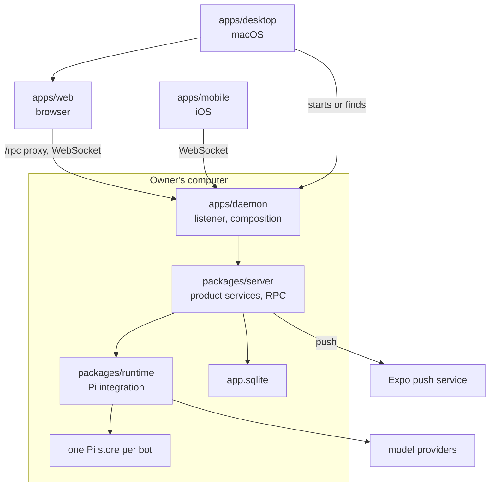
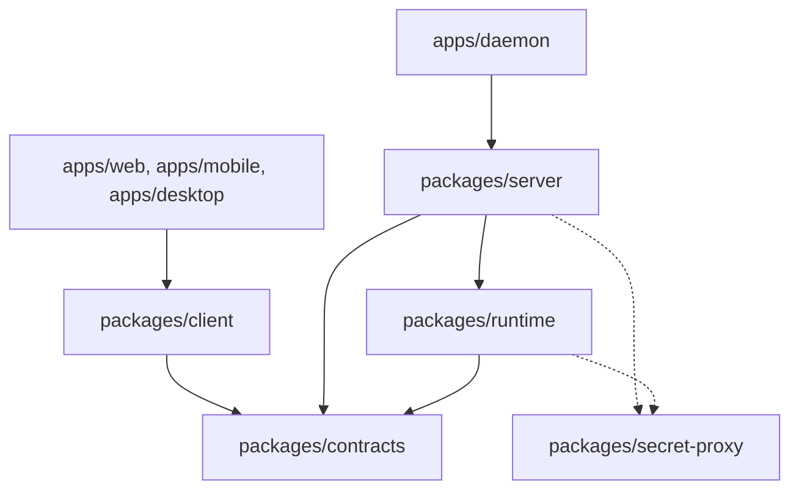
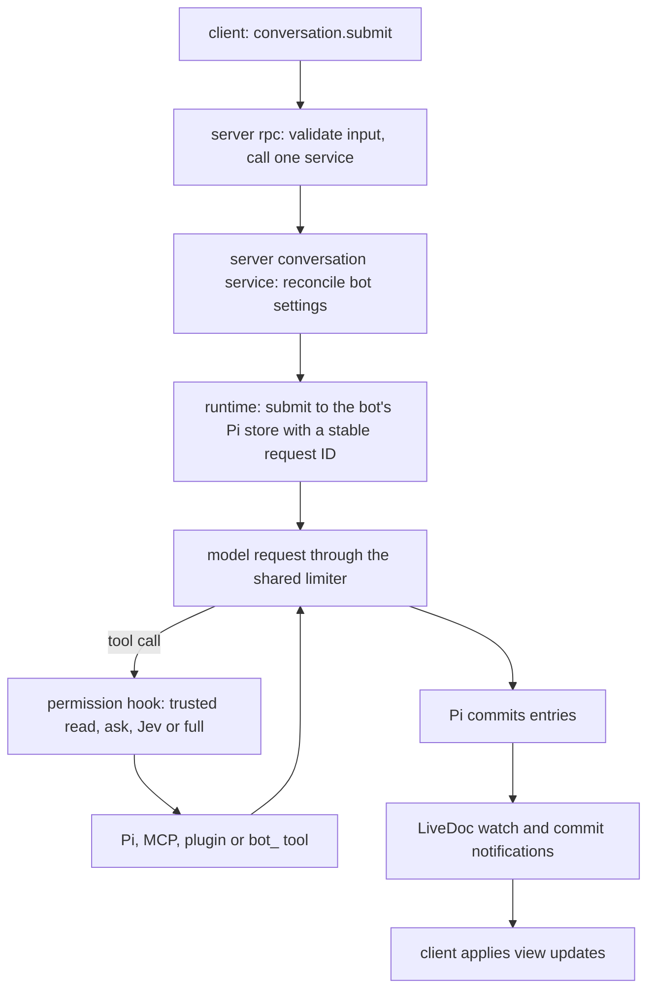

# Architecture

## Rules for this file

1. Agents do not edit this file. Only the owner edits it, or an agent the owner explicitly allowed for that one change.
2. Drifting from these concepts is forbidden. This file describes the allowed target: code that does not match is fixed in the same change, never written down here.
3. Files and folders that match a pattern listed here are allowed, new domains included. A new pattern, file kind, package or concept needs the owner's approval first, and its line lands in the same change. README, `.gitignore`, `.github`, lockfiles and generated files (`routes.tree.ts`, `uniwind-types.d.ts`, `src/paraglide/`) are not file kinds.
4. A tree line is a name pattern plus what it holds, in about 15 words.
5. No history, dates, feature status or workflows. Daemon, RPC and Pi behavior live in the [API reference](api.md).
6. Before writing a file, read a few sibling files of the same kind and follow them.

## 1. How Openbots works

Openbots is a bot backend for one owner. A native daemon on the owner's computer runs each bot as a persistent Pi Durable agent. Web, iOS and macOS clients pair with the daemon and talk to it over oRPC.

### System



### Layers

Each layer only calls the layers below it. Arrows are allowed dependencies.



### A turn



### Entry files

| File | Runs on | Intent |
| --- | --- | --- |
| daemon `src/entry.native.ts` | Bun | the `openbots` CLI: start, pair, service; opens stores and starts the listener |
| daemon `src/entry-backup.native.ts` | Bun | offline backup create and restore |
| server `src/entry.server.ts` | any host | `makeServices`, `coreHandler` and portable product services |
| server `src/entry.native.ts` | Bun | database, backup, workspace, MCP discovery and credential-key factories |
| runtime `src/entry.server.ts` | any host | `makeRuntimeService` and the runtime port types |
| runtime `src/entry.native.ts` | Bun | Pi storage, storage lock, loaders, MCP clients, provider auth |
| contracts `src/entry.universal.ts` | any | the oRPC contract, schemas and public types |
| client `src/entry.{client,react,web,native}.ts` | clients | RPC client; React hooks; DOM-only and Expo-only hooks |
| web `src/application/server.bun.ts` | Bun | production web server: SSR and the `/rpc` proxy |
| mobile `src/app/_layout.tsx` | iOS | Expo Router root: providers, connection, push |
| desktop `src/desktop.ts` | Electrobun | the macOS app: window, tray, local or remote server |

### Naming

- Files are kebab-case. A domain's files start with its folder name: `bot-action.create.ts`, `skill.service.ts`.
- Exports start with their domain: `botActionSend`, `botQueryGet`, `BOT`. Factories are `make<Domain>Service`.
- Name values for what they hold. Singular nouns for items, plural for collections, `At` for timestamps, units for durations (`timeoutMs`).
- Booleans and predicates use positive `is`, `has`, `can` or `should`. Library-defined names keep their names at integration boundaries.
- Openbots-owned Pi tools use the `bot_` prefix (`bot_message`, `bot_question`). Pi, MCP and plugin tools keep their provider names.

## 2. Project structure

### Service pattern (packages/server, packages/runtime, packages/secret-proxy)

```
packages/<package>/src/
├── entry.server.ts                     portable exports, no Bun or file system; secret-proxy has none
├── entry.native.ts                     native factories the daemon injects
├── core/core.services.ts               server only: builds every service once from its deps
├── core/core.handler.ts                server only: the oRPC handler over every rpc file
├── rpc/rpc.<area>.ts                   server only: validates input, calls one service operation
├── rpc/rpc-<part>.utils.ts             helpers shared by rpc files
├── types/<domain>[-<part>].types.ts    the domain's schemas, deps and service types
└── services/<domain>/                  one folder per domain; every file starts with the domain name
    ├── <domain>.service.ts             exports only make<Domain>Service(deps) and its inferred type
    ├── <domain>-action.<name>.ts       one write, (deps, params)
    ├── <domain>-query.<name>.ts        one read without mutations, model calls or connections
    ├── <domain>-<part>.service.ts      a sub-service with its own state, built by the domain service
    ├── <domain>[-<part>].extension.ts  a Pi Durable extension; never renamed once shipped
    ├── <domain>[-<part>].task.ts       a Pi task definition
    ├── <domain>.driver.ts              a low-level adapter: SQLite, HTTP, subprocess
    ├── <domain>.native.ts              the domain's native-only implementation
    ├── <domain>.prompts.ts             model-facing text
    ├── <domain>[-<part>].utils.ts      shared helpers of the domain
    ├── <domain>[-<part>].constants.ts  one SCREAMING_CASE object of config values and limits
    └── migrations/<NNNN>_<name>.sql    server database only: ordered, data-preserving migrations
```

### packages/client

```
packages/client/src/
├── entry.client.ts                     the RPC client and view helpers; no React
├── entry.react.ts                      hooks and TanStack Query options on RPC, Query and React only
├── entry.web.ts  entry.native.ts       hooks that need the DOM, or Expo and React Native
├── client.ts  conversation(s).ts  contexts.ts  notifications.ts    RPC link, reconnect and Pi view state
├── context/<name>.ts                   React contexts the hooks read
├── hooks/use-<name>.ts                 a shared data hook
├── hooks/use-<name>.{web,native}.ts    a platform hook; never the same base name as a shared one
├── services/<domain>/<domain>.client.ts    TanStack Query options and mutations of a domain
├── services/<domain>/<domain>.{utils,constants}.ts    view helpers and constants web and mobile share
├── services/<domain>/<domain>.native.ts    the domain's Expo-only helpers
└── types/<domain>.types.ts             client-side view types
```

### packages/contracts

```
packages/contracts/src/
├── entry.universal.ts                  the package entry
├── rpc/rpc.router.ts                   the oRPC contract of every procedure
└── types/<domain>.types.ts             Zod schemas and inferred types; no implementations
```

### apps/daemon

```
apps/daemon/src/
├── entry.native.ts                     the openbots CLI and daemon entry
├── entry-backup.native.ts              the backup CLI
├── core/core.native.ts                 startup composition and shutdown order
├── core/core-<part>.native.ts          one transport concern: server, rpc, local socket, pairing, command
└── types/core.types.ts                 daemon composition types
```

### apps/web

```
apps/web/
├── vite.config.ts  vite/<name>.vite.ts    Vite config and one plugin group per file
├── public/                             favicons, fonts and static images
└── src/
    ├── application/router.tsx  routes.ts    the router and its route config
    ├── application/server.{bun,tanstack}.ts  styles.css    servers and global styles
    ├── routes/<area>/<area>.<path>.tsx    one route file per URL, TanStack dot names
    ├── routes/handlers/handler.<name>.ts    a non-page HTTP handler
    ├── components/<area>/<area>-<name>.tsx    feature components of one area
    ├── components/ui/<name>.tsx        shared primitives
    ├── services/<domain>/<domain>.{client,utils,constants}.ts    web-only queries, helpers and constants
    ├── hooks/use-<name>.ts             a web-only hook
    ├── context/<name>.ts  lib/<name>.ts    React contexts and tiny generic helpers
    └── types/<domain>.types.ts         web-only types
```

### apps/mobile

```
apps/mobile/
├── app.config.ts  eas.json             Expo config read from env; EAS build and submit profiles
├── babel.config.js  metro.config.js    the Expo toolchain
└── src/
    ├── app/<path>.tsx                  Expo Router screens, one file per route; _layout.tsx per stack
    ├── application/styles.css          Uniwind theme
    ├── components/<area>/<area>-<name>.tsx    feature screens and components of one area
    ├── components/ui/<name>.tsx        shared native primitives
    ├── services/<domain>/<domain>.{client,utils,constants}.ts    mobile-only queries, helpers and constants
    ├── hooks/use-<name>.ts             a mobile-only hook
    ├── context/<name>.ts  lib/<name>.ts    React contexts and tiny generic helpers
    └── types/<domain>.types.ts         mobile-only types
```

### apps/desktop

```
apps/desktop/
├── electrobun.config.ts                app identity and build; signing happens in scripts/desktop.ts release
├── icon.icon/                          the app icon
└── src/
    ├── desktop.ts                      the main process: windows, tray, menus, local or remote server
    ├── desktop-<concern>.ts            one concern: build, network, notify, objc, server, settings, window
    ├── desktop.constants.ts            ports, labels and limits
    ├── types/desktop.types.ts          desktop types
    └── views/<name>/index.{html,ts}    a bundled webview page
```

### Shared packages

```
packages/
├── env/src/entry.{server,client}.ts    typed process and build env; no file reads
├── errors/src/                         shared typed errors and their schemas
├── logger/src/                         structured logging and redaction
├── i18n/messages/en/<area>.json        English copy, one file per area
├── i18n/src/                           Paraglide config and entries; src/paraglide/ is generated
├── avatar-blobs/src/<concern>.ts       the blob avatar engine, player and skins
├── tanstack-helpers/src/<concern>.ts   head, metadata and favicon helpers
├── tooling/src/vitest/                 shared Vitest config
└── typescript-config/{base,react}.json    compiler options every package extends
```

### Root

```
./
├── package.json  turbo.json  oxlint.config.ts  .fallowrc.json    workspace, tasks and checks
├── .env.example                        every env variable with its default
├── AGENTS.md                           agent instructions; CLAUDE.md links to it
├── DESIGN.md                           UI principles
├── README.md                           what Openbots is, setup, scripts
├── scripts/<app>.ts                    one script per app, a subcommand per build, release or dev step
├── .agents/references/<name>.md        standing references: architecture, API, quality gate
├── .agents/docs/<name>.md              library notes: Pi Durable examples
├── .agents/orchestrators/              worktree configs for Paseo, Orca, Conductor and T3 Code, and workspace.sh
├── .agents/sync.ts                     links CLAUDE.md, .claude/ and the orchestrator configs: bun run agents:sync
└── .agents/skills/<name>/SKILL.md      project skill, read by every agent harness
```

## 3. Rules

### Ownership

| Location | Owns |
| --- | --- |
| `apps/daemon` | Entry, startup composition, listener and transport, signals, shutdown. |
| `apps/web`, `apps/desktop`, `apps/mobile` | UI, server connections, device credential storage. Web uses TanStack Start SSR and query hydration; SSR calls the daemon through the shared client, the browser through the `/rpc` proxy with WebSockets for live updates. Web credentials live in a cookie and reach the daemon as Bearer headers. |
| `packages/server` | Product services: bots, pairing, settings, credentials, permissions, skill, instruction, plugin and MCP selection and discovery; RPC handlers. |
| `packages/runtime` | Pi integration: Harness, conversations, tools, hooks, approvals, tasks, watches, recovery, skill, instruction and plugin loading, MCP clients. |
| `packages/contracts` | Public schemas, input and output types, oRPC contracts and errors, including the schemas clients validate forms, search params, pairing codes and stored preferences with. No implementations. |
| `packages/client` | Typed RPC calls, reconnect, applying Pi view updates, and the data and view helpers web and mobile share. Chat and bot hooks live here, not in the apps. `./client` stays free of React. No UI components; apps keep route-bound hooks, toasts and navigation. |
| Shared packages | Env, errors, logging, i18n, avatars, the secret proxy and tooling. No application dependencies. |

Native code stays in its owning package behind `/native`. Using files, SQLite or subprocesses does **not** make code daemon logic.

- Server/native owns app database construction, credential-key loading, workspace directories and MCP configuration-file discovery.
- Runtime/native owns Pi storage, the host alarm, execution environment, image processing for `read`, skill, instruction and plugin loaders, and MCP connections and tools.
- The daemon constructs and injects these services. It does not implement their operations.
- Startup opens stores, runs migrations once, restores bots, resumes Pi, then starts listening. Pairing and other actions use initialized services; they never boot the app or run migrations.
- Shutdown closes the listener, runtime, MCP clients, app database and Pi storage in reverse dependency order, including on startup failure.

### Dependencies

- Packages never import apps. Runtime never imports server or client. Clients never import server or runtime implementations or server env.
- Portable server code never imports `/native` implementations. Inject native service objects; use type-only imports for their public interfaces.
- Use explicit `@repo/*` package exports. No relative imports across packages and no cyclic file or package dependencies, including type-only cycles.
- Read another domain through its public service, not its action, query or driver files. Core wires dependencies; it contains no product decisions.
- The daemon may also import native factories and shared env and logging for composition. These are allowed directions, not permission to import every entry.

### Services

Create only the files an operation needs. Folders are flat. Package entries expose APIs; they do not boot applications.

- Each service has a concrete responsibility. Skill settings and discovery belong to skill; MCP settings and discovery belong to MCP. A combined composer catalog is a response shape, not a `resource` domain.
- Factories receive whole owning services with explicit dependency types, never detached methods or callback bags. Export the factory and its inferred service type.
- Runtime adapters that wrap a domain service for the model use `runtime-<name>.extension.ts`. Pi stores an extension's name in conversation settings, so a shipped name never changes.
- Library callbacks remain callbacks: Pi execution environments, oRPC connections and lazy request context do not need invented services.
- Actions write; queries read without mutations, model calls or starting connections and processes.
- RPC validates input and calls one service operation. Services own policy and database work. URL dispatch belongs to transport and RPC, not auth or other domain services.
- Keep one-use helpers with their owner.

```ts
export function makeSkillService(deps: SkillServiceDeps) {
  return {
    actions: {
      configure: (params: SkillConfigureInput) => skillActionConfigure(deps, params),
    },
    queries: {
      settings: () => skillQuerySettings(deps),
    },
  };
}
export type SkillService = ReturnType<typeof makeSkillService>;
```

### Branching and validation

- Use `ts-pattern` for new and changed conditional branches. Match the value directly; use `.exhaustive()` for closed unions. Keep branches short. Simple predicates and nullish defaults can remain expressions.
- Validate external input once with Zod; trust typed internal values. Use shared errors and logging.

### State and security

- One implicit owner per independent daemon. Devices pair with revocable credentials. No users, organizations, roles or password login.
- Pairing stores token hashes and atomically consumes grants with device creation. Issuing a grant requires an authenticated device or trusted local transport. CLI pairing uses the owner-only daemon socket before or after initial setup; public transport cannot acquire local authority. The daemon prints a startup pairing link while no device exists.
- App persistence uses `node:sqlite` and Kysely. SQL identifiers are snake_case; `CamelCasePlugin` maps TypeScript camelCase. Migrations preserve existing data.
- Generic non-secret key/value data belongs to the shared `settings` service and table, with domain keys such as `skills.directories`, `mcp.paths` and `tools.approvalRules`.
- Domain settings RPCs return settings objects, not individual flags. Writes are partial: omission preserves, `[]` clears lists, nullable fields use `null` to clear. Return updated settings.
- Application secrets use the shared encrypted `credentials` service and table. AES-GCM uses a fresh IV and authenticates the credential name. The native encryption key stays outside the database. No secret-read RPC or secret values in catalogs or errors.
- Pi provider authentication stays in Pi's `ModelRuntime` and auth store. Do not duplicate it in application SQL.
- `env` contains process and build configuration only. Bot settings and secrets belong in persistence. Derive bot directories from the data root and bot ID; never store machine-specific home paths in bot rows. A working directory is not a sandbox.
- Pi owns transcripts and execution state. No SQL message mirror, approval table, second task queue or custom waiter registry.
- Each bot owns one Pi store, `data/bots/<botId>/runtime.sql`; Pi has no delete API, so the store file is the unit of erasure. Never rename an open or recently closed store file; delete it. One daemon lock guards every store. A failed store closes only its bot; an alarm reopens it. Closing a store holds the bot until the file work ends, so no request reopens a store being cleared or deleted. Configure, clear and delete share one per-bot queue.
- Cross-bot work crosses stores through Pi tasks with stable request IDs, never a shared store. Store-local IDs restart after a clear, so cross-store keys include a random per-store ID. Shared extensions and the model-request limiter are built once for all stores.
- Owner chat preferences (pin, hidden, rank, mute, read position) live in app SQL `bot_preference`; Pi supplies only derived summaries.
- Host wake-up goes through the runtime `AlarmService` port: native timer or Cloudflare Durable Object alarm. Each store arms its earliest saved Pi deadline; there is no job table.
- Runtime owns the command catalog and execution. Expose generic `commands.list` and `commands.execute`; new runtime commands must not require new RPC endpoints. Keep Pi command names and dispatch out of server policy and daemon transport.

### Pi and domain integration

Before adding infrastructure, inspect the installed library API and official examples. Use Pi's tools, extensions, documents, tasks, watches and recovery where they fit. State the concrete missing capability before implementing a replacement. Pi's README ships with the installed `@earendil-works/pi-durable` package.

- Server owns product policy. Runtime implements it through Pi hooks and tasks. Install the permission hook last, including for custom and MCP tools.
- Only explicitly trusted tool registrations bypass approval as reads. Names and MCP `readOnlyHint` annotations do not grant trust. Read-only denies other tools; Ask requests approval; Auto uses Jev only for untrusted calls and falls back to Ask; Full allows calls.
- Auto considers owner allow and ask rules in one assessment; ask-first rules win. Recheck policy after Jev and human answers. Load context only when a configured Auto judge needs it.
- Approval decisions and deadlines live in task-scoped Pi documents. Recovery restores their waits; host timers do not wake an offline host. External tool effects are not guaranteed exactly-once.
- Bot identity maps to a stable Pi conversation through a session document. Bot SQL commits before file system and MCP preparation; no external work inside SQL transactions.
- Serialize configuration per bot, keeping other bots parallel. After slow preparation, reread bot and relevant domain settings; retry if relevant values changed before publishing to Pi. `updatedAt` is not a unique version. Restore before resume; reconcile before submission.
- Skill service owns settings and inheritance. Runtime uses Pi `loadSkills` and `formatSkillsForPrompt`, including manual-only discovery. Shared inheritance can be disabled without hiding bot-local skills.
- MCP service owns settings, inheritance, file discovery and merge policy. Runtime clients receive parsed configuration and own connections, tool registration, cancellation and disposal. Runtime does not call server discovery.
- Catalog discovery reads files and current connection state; it never connects. Preparation reuses unchanged clients and closes replaced or disabled clients. Changes to tool definitions change their approval identity. Preserve persisted Pi identifiers across naming refactors.
- Use Pi's standalone MCP client and Durable tools, not a CLI extension compatibility layer. Plugin modules default-export Durable extensions; discovery never imports them. Server preparation resolves encrypted credential references; catalogs never return secret values. MCP OAuth uses Pi's native OAuth helpers with the same encrypted credential store. Exact source precedence and API examples belong in the [API reference](api.md).

### Transport and clients

- The daemon owns the Bun listener and oRPC WebSocket and HTTP adapters. Server owns RPC implementation; contracts own validation and public types.
- Check browser Origin on upgrade and HTTP RPC. Authenticate each network call except token redemption and the MCP OAuth callback page, which a non-paired browser may load and which the one-time `state` of a login a paired device started authorizes; bootstrap is restricted to trusted local transport. Revocation closes active watches, including idle ones.
- Page history with Pi `entries()` and watch `LiveDoc` for current activity. Use commit notifications to advance the saved entry ID; never mount full transcripts for sidebar or live subscriptions. Keep Chord updates and bounded delivery; reconnect catches up from the last loaded entry without resubmitting input.
- Private contexts and subagents are lazy details of the originating chat, not top-level sidebar chats. Read their history and attach live watches only when selected.
- Disconnect and cancel end observation, not accepted agent work. Stop is an explicit command. Never automatically retry commands; submit retries reuse the same Pi request ID.
- Read history through Pi's pagination and opaque cursors. Clients display state; their lifecycle never owns agent execution.

### Routing and screens

- Every screen, panel and dialog is a route, so back, reload, deep links and notification targets work. Web routes live in `application/routes.ts`; mobile screens are Expo Router files registered in `app/_layout.tsx`.
- What a view shows is a path segment (`/rooms/direct/$handle/routines`), not a search param. Search params carry transient options of one view, such as a message to focus or a handoff, validated by a contracts schema.
- A dialog is a child route of the view that opens it. Web renders it through that view's `<Outlet />` and closes with `useDialogNavigation` back to the parent path; mobile sets `transparentModal` for confirmations or `formSheet` for sheets in `_layout.tsx`. Nest a dialog under the panel that opens it, so the panel stays matched behind it.
- A panel in a fixed region, such as the web chat sidebar, is a child route; the region picks its content with `useMatchRoute`, because a route has one outlet.
- Web and mobile use the same path for the same screen where they can (`…/todos`, `…/routines`, `…/media`).
- Native system pickers, action sheets and context menus are controls, not screens, and need no route.

### Mobile UI

- Floating controls use `GlassSurface` or `GlassButton` (Liquid Glass with a flat fallback) inside `FloatingBar`, whose `EdgeFade` blends content behind it. Controls that follow the keyboard sit in `KeyboardSticky`.
- Chat transcripts use `MessageList`, sized by the composer height from `useKeyboardChatComposerInset`.
- The device credential lives in `expo-secure-store`.
- A new native module needs a rebuild of the dev app; `scripts/mobile.ts` detects the native change and rebuilds before Metro starts.

### Shared tooling

- Use Bun and the root dependency catalog: external dependencies use `catalog:`, workspace packages use `workspace:*`. Run `bun install` after manifest changes and retain the lockfile.
- Hosts initialize logging and locale explicitly. Shared packages must not assume Vite, Workers, HTTP ingest routes, locale URLs or cookies. User-facing text uses English i18n keys; Paraglide generates the declarations.
- Every source package has `check`, `lint` and `lint:fix`. Keep Oxlint, Fallow, TypeScript and CI enforcement intact; never weaken checks to fit code. Run the [quality gate](quality-gate.md). Add tests only when requested.
